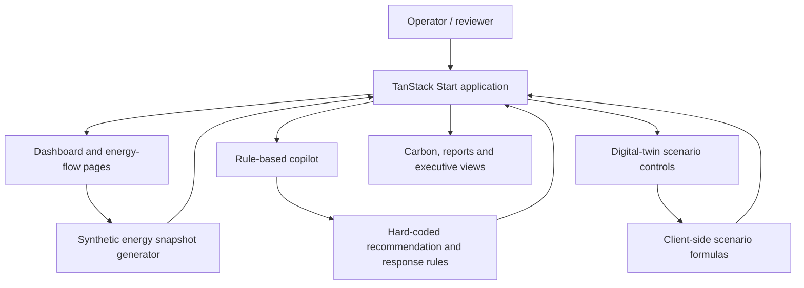

# IntelliGrid Control — Industrial Energy Dashboard Prototype

IntelliGrid Control is a TanStack Start / React interface prototype for exploring an industrial energy operations workspace. It includes a simulated plant dashboard, animated energy-flow view, scripted energy copilot, scenario controls, and executive and carbon reporting screens.


## Why it matters

Industrial energy decisions involve several competing priorities: demand, renewable generation, battery storage, tariffs, operating cost, carbon intensity, and continuity of supply. This prototype explores how an operator-facing workspace could bring those signals and trade-offs into one interface.

## Application architecture



## What is implemented

- Industrial energy dashboard with demand, cost, carbon, source mix, and system-health visualisations.
- Animated source-to-factory flow view for solar, wind, battery, grid, captive generation, and diesel.
- Copilot interface with pre-authored responses for common energy questions.
- Scenario controls for solar capacity, battery size, fuel-price changes, production growth, and grid failure.
- Strategy, forecast, carbon, reports, settings, and executive routes.
- Responsive component system using charts, status indicators, and explainable recommendation cards.

## Important: simulated data, not plant telemetry

This repository is a **front-end demonstration**. The values shown in the dashboard should not be interpreted as measurements from a real factory.

- `src/lib/energy.ts` creates synthetic energy snapshots using a deterministic pseudo-random generator and updates them on a timer. It does not connect to meters, SCADA, PLCs, IoT gateways, or an external telemetry API.
- The copilot uses a local `answerFor()` rule function and a timed UI response. It does not call an LLM or external AI service.
- Recommendation cards and alert examples are defined in local source files; their savings, confidence, model names, and data-point counts are demonstration content.
- The digital-twin page calculates illustrative savings, payback, carbon, and availability values from hard-coded formula coefficients. These outputs are not validated engineering predictions.
- No production dispatch commands or control signals are sent to industrial equipment.

Do not use this prototype for plant operations, energy procurement, emissions reporting, or safety-critical decisions.

## Main routes

| Route | Purpose |
| --- | --- |
| `/` | Public landing page |
| `/app/dashboard` | Energy KPIs and recommendations |
| `/app/energy-flow` | Source-to-load flow visualisation |
| `/app/copilot` | Scripted energy Q&A experience |
| `/app/digital-twin` | Client-side scenario simulator |
| `/app/carbon` | Carbon and emissions views |
| `/app/forecasts` | Demand and generation forecast UI |
| `/app/scenarios` | Strategy scenario exploration |
| `/app/reports` | Reporting interface |
| `/app/executive` | Executive summary |
| `/app/settings` | Plant and workspace settings UI |

## Technology

TanStack Start · TanStack Router · React 19 · TypeScript · Vite · Tailwind CSS · Recharts · Framer Motion · Lucide

## Run locally

```bash
npm install
npm run dev
```

Production build and lint:

```bash
npm run build
npm run lint
npm run preview
```

The current `package.json` does not define an automated test or benchmark command.

## Next integration boundary

A real deployment would require authenticated data ingestion, a plant-specific data model, validated optimisation or forecast services, role-based authorisation, auditable control approvals, and hardware-in-the-loop testing before any setpoint or dispatch integration.

[Browse the source](https://github.com/MokuLakshithReddy/intelligrid-control)
